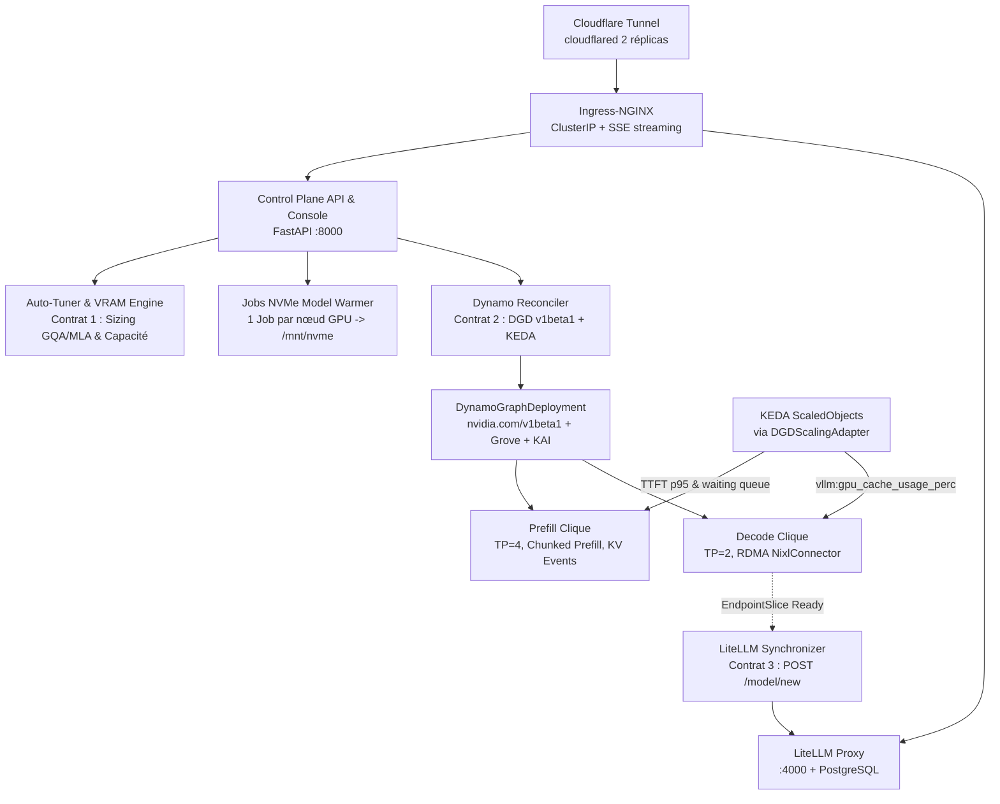

# Plateforme d'Inférence Kubernetes + NVIDIA Dynamo + LiteLLM + Cloudflare

Plateforme d'inférence distribuée multi-modèles à haute performance, conçue pour orchestrer des LLMs en architecture désagrégée (Prefill & Decode) avec NVIDIA Dynamo (`v1.5.1`, `nvidia.com/v1beta1`), synchronisation à chaud dans LiteLLM Proxy, autoscaling KEDA et exposition sécurisée sans port entrant via Cloudflare Tunnel.

- **Documentation complète** : [docs/README.md](docs/README.md) (guides d'installation, architecture, API, opérations, sécurité).
- **Plan de suivi & intégrations amont (2025–2026)** : [docs/followup-plan.md](docs/followup-plan.md) (correctifs post-audit, intégrations `hf_xet`, Run:ai Model Streamer, LMCache + NIXL, Dynamo Planner / Kubernetes Gateway API Inference Extension, LiteLLM + Redis, et exécution des Vagues 4–5).
- **Audit architectural & catalogue forensique des défauts** : [docs/architecture-audit.md](docs/architecture-audit.md) et [docs/audit-defect-catalog.md](docs/audit-defect-catalog.md).
- **Déploiement multi-clusters** : [deploy/README.md](deploy/README.md) (images immuables par digest SHA-256, secrets isolés par cluster, preflight checks).
- **Collecte de données & Fine-Tuning LoRA** : [docs/data-and-fine-tuning.md](docs/data-and-fine-tuning.md) (workflow opt-in de collecte d'inférence, revue humaine, datasets JSONL immuables, entraînement LoRA mono-GPU et promotion épinglée par commit Hugging Face).

---

## Console Web & Démarrage Rapide

La console web servie sur `/` ([control-plane/README.md](control-plane/README.md)) prend en charge :
- Connexion administrateur par mot de passe (Argon2id + cookie `HttpOnly; SameSite=Strict` + CSRF) ou par token Bearer.
- Vue temps réel des déploiements, de l'inventaire des pools GPU et des détails de dimensionnement Auto-Tuner.
- Métriques Prometheus en direct (`GET /api/v1/metrics/usage` : débits de requêtes/tokens, TTFT p95, occupation KV-cache et GPU DCGM).
- Opérations Kubernetes (`GET /api/v1/cluster/nodes`, inspection des pods, consultation des logs conteneurs, ajustement des réplicas avec contrôle de capacité SKU et éviction/remplacement de pods).

Pour essayer la console localement en mode simulé (Python 3.11) :

```bash
python3.11 -m venv .venv
source .venv/bin/activate
pip install -e ".[dev]"
CONTROL_PLANE_MOCK=1 uvicorn api.main:app --host 127.0.0.1 --port 8000
```

Ouvrir `http://127.0.0.1:8000` et utiliser `test-token` pour se connecter (ou exécuter `python -m api setup` pour configurer un compte administrateur local dans `.inference/config.json`).

Alternative Docker en simulation locale :

```bash
docker build -t ai-inference-control-plane:local -f control-plane/Dockerfile .
docker run --rm -p 127.0.0.1:8000:8000 -e CONTROL_PLANE_MOCK=1 ai-inference-control-plane:local
```

La référence API interactive OpenAPI 3.1 est disponible sur `/docs`.

---

## 1. Architecture Globale et DAG d'Exécution



---

## 2. Structure du Monorepo

- `contracts/` : Contrats d'interfaces figés (JSON Schema Draft 2020-12 & OpenAPI 3.1).
  - `model_spec.schema.json` : Entrée/sortie du calculateur Auto-Tuner (**Contrat 1**).
  - `dynamo_crd.schema.json` : Validation `DynamoGraphDeployment` `nvidia.com/v1beta1` (**Contrat 2**).
  - `data_workflow.schema.json` : Schémas de collecte, revue, datasets, entraînement LoRA et promotion.
  - `control_plane_openapi.yaml` : Spécification REST complète générée via `scripts/export_data_contracts.py`.
- `control-plane/` :
  - `autotuner/` : Inspecteur Hugging Face (`hf_inspector.py`), calculateur VRAM GQA/MLA (`vram_calculator.py`), planificateur SLA (`sla_planner.py`).
  - `api/` : Serveur FastAPI (`main.py`), authentification Argon2/CSRF (`auth.py`), client K8s async (`k8s_client.py`), contrôles opérationnels K8s (`k8s_controls.py`), réconciliateur Dynamo/KEDA (`dynamo_reconciler.py`), synchroniseur LiteLLM (`litellm_sync.py`), télémétrie Prometheus (`metrics.py`), workflow data/training (`data_*.py`, `training*.py`), et console SPA (`web/`).
- `dynamo/` :
  - `helm-values/dynamo-platform-values.yaml` : Configuration NVIDIA Dynamo Platform, Grove et KAI Scheduler.
  - `templates/` : Gabarits Jinja2 `dgd-disaggregated.yaml.j2`, `dgd-aggregated.yaml.j2` et `dgd-components.yaml.j2`.
- `loader/` :
  - `model_warmer.py`, `warmer-job.yaml.j2`, `Dockerfile` : Pré-chargement parallèle Hugging Face vers `/mnt/nvme/model-cache/hub/models--...`.
- `gateway/` :
  - `litellm-deployment.yaml`, `config.example.yaml`, `data_capture.py`, `README.md` : Passerelle LiteLLM Proxy, StatefulSet PostgreSQL et callback opt-in de capture.
- `infra/` : Manifests Kubernetes (`control-plane-deployment.yaml`, `control-plane-rbac.yaml`, `data-workflow.yaml`, `gpu-operator/`, `network-rdma/`, `storage-nvme/`, `cloudflare/`).
- `monitoring/` : `keda-scaledobjects.yaml.j2` (ciblant `DynamoGraphDeploymentScalingAdapter`) et `prometheus-rules.yaml`.
- `training/` : `train.py`, `smoke_test.py`, `Dockerfile`, `requirements.txt` (SFT LoRA mono-GPU avec TRL/PEFT et évaluation sur splits de validation/test).
- `scripts/` : `bootstrap_inference_cluster.sh`, `deploy_clusters.py`, `install_litellm.py`, `validate_manifests.py`, `configure_data_workflow.py`, `export_data_contracts.py`.
- `tests/` : 17 modules pytest (**145 tests**) couvrant l'ensemble des composants et la suite de vérification d'audit (`test_audit_defects_poc.py`).

---

## 3. Formules Mathématiques du Calculateur VRAM

1. **Mémoire des Poids ($M_{\text{weights}}$)** :
   $$M_{\text{weights}} = N_{\text{params}} \times B_{\text{dtype}} \times 1.05$$
   où $B_{\text{dtype}} = 2.0$ octets (BF16/FP16), $1.0$ octet (FP8), ou $0.55$ octet (AWQ/GPTQ/INT4).

2. **Mémoire du KV-Cache par Token ($M_{\text{kv\_token}}$)** :
   - **GQA standard** : $M_{\text{kv\_token}} = 2 \times L \times H_{\text{kv}} \times D_{\text{head}} \times B_{\text{kv\_dtype}}$
   - **DeepSeek MLA** : $M_{\text{kv\_token}} = L \times (\text{kv\_lora\_rank} + \text{qk\_rope\_head\_dim}) \times B_{\text{kv\_dtype}}$

3. **Allocation Totale et Sélection de $(TP, PP)$** :
   $$M_{\text{total}} = \frac{M_{\text{weights}} + (M_{\text{kv\_token}} \times C_{\text{max}} \times B_{\text{seq}}) + M_{\text{cuda\_graphs}}}{\text{gpu\_memory\_utilization}}$$
   Avec vérification stricte de divisibilité sur les têtes Key/Value **et** Query ($H_{\text{kv}} \pmod{TP} = 0$ et $H_{\text{q}} \pmod{TP} = 0$) et repli sur Pipeline Parallelism ($PP \in \{2, 4\}$) si un nœud unique ne suffit pas.

---

## 4. Validation des Quality Gates

```bash
python3.11 -m venv .venv
source .venv/bin/activate
pip install -e ".[dev]" shellcheck-py

# Linter, typage et scripts shell
ruff check control-plane/ loader/ tests/ gateway/data_capture.py training/ scripts/*.py
mypy --ignore-missing-imports control-plane/ loader/ scripts/*.py
shellcheck scripts/*.sh

# Suite de tests complète (145 tests unitaires, E2E mockés et PoC d'audit)
CONTROL_PLANE_MOCK=1 pytest -v tests/

# Validation stricte des manifestes K8s et CRDs (kubeconform v0.7.0)
python -m scripts.validate_manifests --kubeconform /path/to/kubeconform
```
