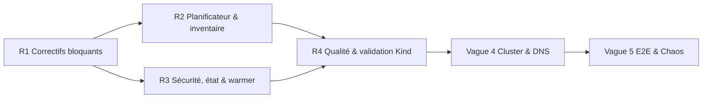

# Plan d'Exécution Multi-Agents : Plateforme d'Inférence Kubernetes + NVIDIA Dynamo + LiteLLM + Cloudflare

Ce document définit l'architecture organisationnelle, les contrats d'interface, l'arborescence du monorepo, le graphe de dépendances (DAG) et les instructions système pour une **équipe de 6 agents autonomes** chargée de construire, tester et déployer l'intégralité de la plateforme d'inférence distribuée.

## 0. État d'Avancement (revue du 2026-10-13)

Le commit `2a782cc` livre un **squelette complet des vagues 1 à 3** (≈ 3,9 k lignes, 8 tests `pytest` verts). Les vagues 4 et 5 (cluster réel, Cloudflare, E2E réel) **n'ont pas été exécutées** : tous les tests reposent sur des mocks.

| **Composant** | **Statut** | **Commentaire** |
|---|---|---|
| `contracts/` | ⚠️ | Présents, mais Contrat 1 confond `dtype` et `quantization` ; Contrat 2 non aligné sur le vrai CRD Dynamo. |
| `scripts/`, `infra/` | ⚠️ | Rédigés et `shellcheck`-és, jamais appliqués sur un cluster. Secrets en clair / placeholders. |
| `dynamo/templates/` | ❌ | Schéma DGD probablement inventé (`backend`, `model`, `sharedStorage`, `extraArgs`) ; `--quantization=bf16` invalide pour vLLM. |
| `control-plane/autotuner/` | ⚠️ | Formules OK, mais planificateur ignorant la capacité réelle (réplicas figés, decode TP/2 sans vérif mémoire). |
| `control-plane/api/` | ❌ | Fallbacks mock silencieux, état en mémoire, Job warmer jamais lancé, API sans authentification. |
| `loader/` | ⚠️ | Script OK, non intégré au flux de déploiement. |
| `monitoring/` | ⚠️ | Templates présents, non testés. |
| `tests/`, CI | ⚠️ | Unitaires mockés uniquement ; pas de kubeconform, lint, typage ni build Docker en CI. |

### Défauts identifiés (référencés dans le plan de remédiation §4bis)

| **ID** | **Sévérité** | **Défaut** | **Fichier(s)** | **Agent** |
|---|---|---|---|---|
| D1 | 🔴 Critique | Bascule silencieuse en mode mock (K8s & LiteLLM) ; `deregister_model` renvoie `True` en cas d'échec → 502 au retrait. | `api/k8s_client.py`, `api/litellm_sync.py` | 4 |
| D2 | 🔴 Critique | `--quantization=bf16/fp16` invalide : ces valeurs relèvent de `--dtype`. | `dynamo/templates/*`, `autotuner/sla_planner.py` | 2, 3 |
| D3 | 🔴 Critique | Templates DGD non conformes au CRD réel de l'opérateur Dynamo. | `dynamo/templates/*`, `contracts/dynamo_crd.schema.json` | 2 |
| D4 | 🔴 Critique | Planificateur sans contrainte de capacité : réplicas figés 2+4, `decode_tp = tp/2` sans vérif VRAM, fallback TP même si le modèle ne tient pas. | `autotuner/sla_planner.py`, `autotuner/vram_calculator.py` | 3 |
| D5 | 🟠 Majeur | Inventaire GPU codé en dur (H100-80GB, RDMA, `available = total`). | `api/k8s_client.py` | 4 |
| D6 | 🟠 Majeur | Job de pré-chargement NVMe jamais lancé ; timeout readiness de 2 min trop court. | `api/dynamo_reconciler.py`, `loader/` | 3, 4 |
| D7 | 🔴 Critique | API Control Plane exposée sans authentification ; master keys en clair. | `api/main.py`, `gateway/*`, `infra/cloudflare/*` | 1, 4 |
| D8 | 🟠 Majeur | État des déploiements en mémoire (perdu au redémarrage), drain fixe de 15 s en `BackgroundTask`. | `api/dynamo_reconciler.py`, `api/main.py` | 4 |
| D9 | 🟠 Majeur | Inspecteur HF : estimation des paramètres fausse (GQA/MoE), pas de `head_dim` explicite ni MLA, `bfloat16` non normalisé, fallback silencieux sur un profil 70B. | `autotuner/hf_inspector.py` | 3 |
| D10 | 🟡 Mineur | Packaging bricolé (symlink `control_plane`, `sys.path`). | racine, `api/main.py` | 0 |
| D11 | 🟡 Mineur | Tests E2E mockés ; CI Python 3.11 vs local 3.14 ; pas de kubeconform/ruff/mypy/docker build. | `tests/`, `.github/` | 5, 0 |
| D12 | 🟡 Mineur | Noms de déploiement non validés RFC 1123. | `autotuner/sla_planner.py` | 3 |

## 1. Topologie de l'Équipe d'Agents et Responsabilités

Chaque agent possède un périmètre d'écriture strict dans le monorepo afin d'éviter tout conflit de fusion lors des exécutions parallèles.

| **ID Agent** | **Rôle** | **Périmètre Monorepo** | **Responsabilités Clés** |
|---|---|---|---| 
| **Agent 0** | **Lead Architect & Orchestrator** | `/`, `contracts/`, `.github/` | Définit les schémas Pydantic/OpenAPI partagés, orchestre le DAG d'exécution, valide les Quality Gates et fusionne les branches. | 
| **Agent 1** | **Infra, K8s & Cloudflare Network** | `infra/`, `scripts/` | Automatise l'installation OS/GPU, K3s, [NVIDIA GPU Operator](https://docs.nvidia.com/datacenter/cloud-native/gpu-operator/latest/), Ingress-NGINX, [Cloudflare Tunnel et ExternalDNS](https://itnext.io/exposing-kubernetes-apps-to-the-internet-with-cloudflare-tunnel-ingress-controller-and-e30307c0fcb0), **Cloudflare Access** devant le Control Plane, gestion des secrets (pas de secret en clair dans Git). | 
| **Agent 2** | **NVIDIA Dynamo & Disaggregated Serving** | `dynamo/` | Déploie [NVIDIA Dynamo Platform](https://docs.nvidia.com/dynamo/) (CRDs, Grove, KAI Scheduler), conçoit les templates `DynamoGraphDeployment` (Prefill/Decode) et configure le transfert KV-Cache RDMA/NVLink. | 
| **Agent 3** | **Auto-Tuner & Model Loader Engine** | `control-plane/autotuner/`, `loader/` | Inspecte les métadonnées Hugging Face / S3 (`config.json`), calcule la VRAM (poids + KV-Cache), déduit TP/PP/Quantization/Ratio P-D et gère le pré-chargement sur cache NVMe. | 
| **Agent 4** | **Control Plane API & LiteLLM Sync** | `control-plane/api/`, `gateway/` | Développe le WebService FastAPI, pilote les CRDs Kubernetes, surveille les `EndpointSlices` et synchronise à chaud les modèles dans [LiteLLM Proxy](https://docs.litellm.ai/docs/proxy/model_management) (`/model/new`, `/model/delete`). | 
| **Agent 5** | **Autoscaling (KEDA), Observabilité & QA** | `monitoring/`, `tests/` | Configure Prometheus + DCGM Exporter, crée les `ScaledObject` KEDA basés sur les métriques vLLM/Dynamo et exécute les tests de bout en bout (E2E) et de charge. | 

## 2. Arborescence Cible du Monorepo

Tous les agents travaillent sur une structure de dépôt unifiée :

```
ai-inference-platform/
├── pyproject.toml                    # [Agent 0] Packaging unique (remplace symlink control_plane + sys.path)
├── contracts/                        # [Agent 0] Contrats figés entre agents
│   ├── model_spec.schema.json        # Entrée/Sortie du calculateur Auto-Tuner
│   ├── dynamo_crd.schema.json        # Schéma de génération DynamoGraphDeployment
│   └── control_plane_openapi.yaml    # Spécification REST du WebService
├── scripts/                          # [Agent 1] Scripts d'initialisation bare-metal
│   └── bootstrap_inference_cluster.sh
├── infra/                            # [Agent 1] Manifests K8s d'infrastructure
│   ├── gpu-operator/
│   ├── network-rdma/
│   ├── storage-nvme/
│   └── cloudflare/                   # cloudflared + external-dns + ingress-nginx
├── dynamo/                           # [Agent 2] Templates & CRDs NVIDIA Dynamo
│   ├── helm-values/
│   └── templates/
│       ├── dgd-disaggregated.yaml.j2 # Template Prefill/Decode séparés (Grove)
│       └── dgd-aggregated.yaml.j2    # Template standard monobloc
├── loader/                           # [Agent 3] Job/Daemon de cache NVMe
│   ├── Dockerfile
│   ├── warmer-job.yaml.j2            # [R3] Job K8s de pré-chargement lancé par le Control Plane
│   └── model_warmer.py               # Téléchargement parallèle HF/S3 -> NVMe
├── control-plane/                    # [Agent 3 & Agent 4] Backend Python FastAPI
│   ├── autotuner/                    # [Agent 3] Calculateur VRAM, TP, PP, P/D Ratio
│   │   ├── hf_inspector.py
│   │   ├── vram_calculator.py
│   │   └── sla_planner.py
│   └── api/                          # [Agent 4] Serveur FastAPI + K8s Watcher + LiteLLM
│       ├── main.py
│       ├── k8s_client.py
│       ├── dynamo_reconciler.py
│       └── litellm_sync.py
├── gateway/                          # [Agent 4] Configuration LiteLLM + Postgres + Redis
│   ├── litellm-deployment.yaml
│   └── config.yaml
├── monitoring/                       # [Agent 5] KEDA, Prometheus, Grafana
│   ├── keda-scaledobjects.yaml.j2
│   └── prometheus-rules.yaml
└── tests/                            # [Agent 5] Suite de validation unitaire & E2E
    ├── test_vram_calculator.py
    ├── test_crd_rendering.py
    └── e2e_deployment_flow.py

```

## 3. Contrats d'Interface Techniques (Handshakes Inter-Agents)

Pour permettre aux agents 2, 3 et 4 de coder simultanément sans blocage, l'**Agent 0** verrouille trois contrats de données dès l'initialisation.

### Contrat 1 : Sortie de l'Auto-Tuner (Agent 3 -> Agent 2 & Agent 4)

L'Agent 3 expose une fonction pure `compute_deployment_plan(request: DeployRequest, cluster_gpu_inventory: ClusterInventory) -> DeploymentPlan` qui retourne la structure suivante :

```
{
  "model_id": "meta-llama/Llama-3.3-70B-Instruct",
  "deployment_name": "llama-3-3-70b-instruct",
  "serving_mode": "disaggregated",
  "dtype": "bfloat16",
  "quantization": "fp8",
  "max_model_len": 32768,
  "gpu_memory_utilization": 0.90,
  "estimated_vram_gb_per_replica": 78.4,
  "prefill_clique": {
    "replicas": 2,
    "tensor_parallel_size": 4,
    "pipeline_parallel_size": 1,
    "gpu_sku": "NVIDIA-H100-80GB",
    "max_num_batched_tokens": 16384,
    "enable_chunked_prefill": true
  },
  "decode_clique": {
    "replicas": 4,
    "tensor_parallel_size": 2,
    "pipeline_parallel_size": 1,
    "gpu_sku": "NVIDIA-H100-80GB",
    "max_num_seqs": 256
  },
  "kv_cache_transfer": {
    "protocol": "rdma",
    "engine": "nixl"
  }
}

```

**Règles du Contrat 1 (révision R1/R2) :**

* `dtype` ∈ {`auto`, `bfloat16`, `float16`} → passé à `--dtype`. `quantization` ∈ {`null`, `fp8`, `awq`, `gptq`} → passé à `--quantization` **uniquement s'il n'est pas `null`** (corrige D2).
* Clé `engine` en minuscules uniquement (suppression du doublon `Engine`).
* `deployment_name` conforme RFC 1123 (`^[a-z]([-a-z0-9]{0,61}[a-z0-9])?$`), validé par le schéma (D12).
* **Contrainte de capacité** : `Σ(replicas × TP × PP)` sur toutes les cliques ≤ GPU disponibles du pool cible. Sinon, la fonction lève `InsufficientCapacityError` (HTTP 409) au lieu de dégrader silencieusement (D4).
* Chaque clique doit tenir en mémoire **avec son propre TP** (le decode ne peut réduire son TP que si la VRAM le permet).

### Contrat 2 : Rendu du CRD `DynamoGraphDeployment` (Agent 2 -> Agent 4)

L'Agent 2 fournit un moteur de rendu Jinja2 qui transforme le `DeploymentPlan` JSON en manifeste Kubernetes `DynamoGraphDeployment` valide pour le [Dynamo Operator](https://docs.nvidia.com/dynamo/) :

> [!WARNING]
> **D3 — Le squelette ci-dessous est indicatif et non conforme au CRD réel.** Avant toute modification des templates, l'Agent 2 doit extraire le schéma officiel (`kubectl explain dynamographdeployment.spec --recursive` ou le CRD du chart Helm de la version Dynamo épinglée), le figer dans `contracts/dynamo_crd.schema.json`, puis réécrire les templates (structure attendue de type `services.<Nom>.componentType`, `extraPodSpec.mainContainer.args`, volumes/env explicites). Les variables `VLLM_KV_CACHE_TRANSFER_*` doivent être remplacées par la configuration KV-transfer réellement supportée (NIXL).

```
apiVersion: nvidia.com/v1alpha1
kind: DynamoGraphDeployment
metadata:
  name: "{{ deployment_name }}"
  namespace: "{{ namespace }}"
  labels:
    app.kubernetes.io/managed-by: dynamo-control-plane
spec:
  backend: vllm
  model: "{{ model_id }}"
  sharedStorage:
    hostPath: "/mnt/nvme/model-cache"
  services:
    Frontend:
      replicas: 2
      ports:
        - name: http
          port: 8000
    PrefillWorker:
      replicas: {{ prefill_clique.replicas }}
      resources:
        limits:
          nvidia.com/gpu: {{ prefill_clique.tensor_parallel_size }}
      extraArgs:
        - "--tensor-parallel-size={{ prefill_clique.tensor_parallel_size }}"
        - "--dtype={{ dtype }}"
        
        - "--quantization={{ quantization }}"
        
        - "--max-model-len={{ max_model_len }}"
        - "--gpu-memory-utilization={{ gpu_memory_utilization }}"
    DecodeWorker:
      replicas: {{ decode_clique.replicas }}
      resources:
        limits:
          nvidia.com/gpu: {{ decode_clique.tensor_parallel_size }}
      extraArgs:
        - "--tensor-parallel-size={{ decode_clique.tensor_parallel_size }}"
        - "--dtype={{ dtype }}"
        
        - "--quantization={{ quantization }}"
        
        - "--max-model-len={{ max_model_len }}"

```

### Contrat 3 : Synchronisation Dynamique LiteLLM (Agent 4)

Dès que l'`EndpointSlice` du service `{{ deployment_name }}-frontend` passe à `Ready=true`, l'Agent 4 exécute l'appel REST suivant vers [LiteLLM Proxy](https://docs.litellm.ai/docs/proxy/model_management) :

```
POST http://litellm-service.ai-gateway.svc.cluster.local:4000/model/new
Authorization: Bearer <LITELLM_MASTER_KEY>
Content-Type: application/json

{
  "model_name": "llama-3.3-70b",
  "litellm_params": {
    "model": "openai/meta-llama/Llama-3.3-70B-Instruct",
    "api_base": "http://llama-3-3-70b-frontend.dynamo-workloads.svc.cluster.local:8000/v1",
    "api_key": "internal-dynamo-key",
    "rpm": 1000,
    "timeout": 600
  },
  "model_info": {
    "id": "dgd-llama-3-3-70b",
    "mode": "chat",
    "supports_function_calling": true
  }
}

```

**Règles du Contrat 3 (révision R1) :**

* **Aucun fallback mock implicite** : un échec HTTP de `/model/new` ou `/model/delete` est une erreur, avec retry exponentiel (3 tentatives) puis statut `failed` exposé par l'API (D1).
* Le retrait K8s n'a lieu **que si** `/model/delete` a réussi ; sinon la suppression est bloquée et signalée.
* Le mode mock n'existe que s'il est demandé explicitement (`CONTROL_PLANE_MOCK=1`) et est refusé lorsque l'API tourne in-cluster.
* `LITELLM_MASTER_KEY` est lue exclusivement depuis un Secret Kubernetes ; aucune valeur par défaut dans le code.

## 4. Plan d'Exécution Séquentiel et Parallèle (DAG en 5 Vagues)

Le projet est découpé en **5 vagues (Waves)**. Au sein d'une même vague, les agents travaillent simultanément.

| **Vague** | **Agents Actifs** | **Tâches Exécutées en Parallèle** | **Critère de Validation (Quality Gate)** |
|---|---|---|---| 
| **Vague 1 : Fondations & Contrats** | **Agent 0**, **Agent 1** | **Agent 0** : Initialise le monorepo et publie les 3 schémas dans `contracts/`.  **Agent 1** : Finalise `bootstrap_inference_cluster.sh`, les manifests Cloudflare Tunnel (`cloudflared`), `external-dns` et le StorageClass NVMe. | Validation syntaxique `shellcheck` / `kubeconform` sur `infra/` et validation JSON Schema sur `contracts/`. | 
| **Vague 2 : Développement Cœur (Parallèle)** | **Agent 2**, **Agent 3**, **Agent 4** | **Agent 2** : Écrit les templates Jinja2 `DynamoGraphDeployment` (agrégé et désagrégé P/D) + scripts d'init RDMA.  **Agent 3** : Code l'inspecteur Hugging Face (`hf_inspector.py`), le calculateur de VRAM (`vram_calculator.py`) et le job de pré-chargement NVMe (`model_warmer.py`).  **Agent 4** : Développe l'API FastAPI (`POST /models/deploy`, `DELETE /models/{id}`, `GET /cluster/gpus`), le client K8s (`kubernetes_asyncio`) et le connecteur LiteLLM. | Tests unitaires isolés : l'Agent 3 génère un JSON conforme au Contrat 1 ; l'Agent 2 produit un YAML valide selon le Contrat 2 ; l'Agent 4 passe les tests avec mocks K8s/LiteLLM. | 
| **Vague 3 : Autoscaling & Intégration** | **Agent 0**, **Agent 4**, **Agent 5** | **Agent 5** : Crée les templates `ScaledObject` KEDA basés sur les métriques Prometheus de Dynamo (`vllm:num_requests_waiting`, `vllm:gpu_cache_usage_perc`).  **Agent 4 & Agent 0** : Intègrent les modules `autotuner/` (Agent 3) et `dynamo/templates/` (Agent 2) dans le pipeline de déploiement de `control-plane/api/`. | Construction de l'image Docker du Control Plane réussie et lancement du conteneur en environnement de test (Kind / K3s). | 
| **Vague 4 : Déploiement Cluster & DNS** | **Agent 1**, **Agent 2**, **Agent 4** | Exécution du bootstrap sur le cluster cible : installation GPU Operator, Dynamo Platform (avec Grove & KAI), LiteLLM + Postgres, Ingress-NGINX, Cloudflare Tunnel et Control Plane. | `kubectl get pods -A` affiche 100 % des pods en état `Running` ; `https://llm.<domaine>/health/readiness` et `https://control.<domaine>/health` répondent `200 OK` via Cloudflare. | 
| **Vague 5 : Recette E2E & Chaos Testing** | **Agent 5**, **Agent 0** | **Agent 5** : Déploie un modèle test via `POST https://control.<domaine>/api/v1/models/deploy`, vérifie le téléchargement NVMe, l'instanciation du CRD Dynamo, l'enregistrement automatique dans LiteLLM et lance un tir de charge streaming SSE. Simule la suppression (`DELETE`) et vérifie le drain sans erreur HTTP 502. | Zéro requête perdue lors de l'enregistrement et du retrait du modèle ; latence TTFT/TPOT conforme aux objectifs. | 

> [!NOTE]
> Statut au 2026-10-13 : vagues 1–3 livrées sous forme de squelette (Quality Gate de la vague 3 — build Docker + Kind/K3s — **non validée**). Les vagues de remédiation R1–R4 ci-dessous doivent être terminées **avant** de lancer les vagues 4 et 5.

## 4bis. Plan de Remédiation (Vagues R1 → R4)



| **Vague** | **Agents** | **Tâches** | **Défauts** | **Quality Gate** |
|---|---|---|---|---|
| **R1 : Correctifs bloquants** | 2, 3, 4 | **Agent 4** : supprimer les fallbacks mock implicites, mode mock opt-in via `CONTROL_PLANE_MOCK=1`, erreurs propagées et retry LiteLLM. **Agent 3** : séparer `dtype` / `quantization` dans le plan. **Agent 2** : extraire le CRD Dynamo réel, mettre à jour `contracts/dynamo_crd.schema.json` et réécrire les deux templates. | D1, D2, D3 | Tests prouvant qu'une kubeconfig absente ou un LiteLLM injoignable produit une erreur ; manifestes rendus validés contre le CRD réel via `kubeconform` ; aucun `--quantization=bf16/fp16` rendu possible. |
| **R2 : Planificateur & inventaire** | 3, 4 | **Agent 3** : contrainte de capacité globale, réplicas dérivés des GPU libres et du profil, vérif VRAM par clique, pipeline parallel ou `InsufficientCapacityError` si TP=8 insuffisant ; inspecteur HF basé sur `model.safetensors.index.json` (`metadata.total_size`), support `head_dim` explicite, MLA, MoE, normalisation `torch_dtype`, erreur explicite pour modèle introuvable ; validation RFC 1123. **Agent 4** : inventaire réel via labels GFD (`nvidia.com/gpu.product`, `nvidia.com/gpu.memory`, `nvidia.com/gpu.count`) et GPU déjà alloués par les pods. | D4, D5, D9, D12 | Tests paramétrés (Llama 8B/70B, Qwen 72B, Mixtral, DeepSeek) : aucun plan ne dépasse la capacité ; 70B en bf16 sur 8×H100 → plan cohérent ; 405B sur 8×H100 → 409. |
| **R3 : Sécurité, état & warmer** | 1, 3, 4 | **Agent 1** : Cloudflare Access sur `control.<domaine>`, secrets via Secret/ExternalSecrets (suppression des clés en clair de `gateway/`). **Agent 4** : authentification API (JWT Cloudflare Access ou token), état persistant dérivé des CR (labels/annotations + `status`), boucle de réconciliation au démarrage, drain piloté par `vllm:num_requests_running` (timeout configurable). **Agent 3** : `loader/warmer-job.yaml.j2`. **Agent 4** : lancer le Job warmer avant le DGD, attendre sa complétion, timeout readiness configurable (≥ 30 min pour les gros modèles). | D6, D7, D8 | Redémarrage du Control Plane sans perte d'état ; requête non authentifiée → 401 ; `git grep` sans secret ; enchaînement warmer → DGD → LiteLLM testé. |
| **R4 : Qualité & validation Kind** | 0, 5 | **Agent 0** : `pyproject.toml`, suppression du symlink et des `sys.path`, version Python unique (3.12) en local et en CI. **Agent 5** : CI avec `ruff`, `mypy`, `kubeconform` (infra + manifestes rendus), build Docker ; test d'intégration sur Kind avec les CRD Dynamo installés et un faux backend OpenAI-compatible (sans GPU). | D10, D11 | CI verte avec tous les jobs ; le flux `POST /deploy` → CR créé → EndpointSlice prêt → LiteLLM enregistré → `DELETE` passe sur Kind. |

## 5. Algorithme Détaillé pour l'Agent 3 (Auto-Tuner & Calculateur VRAM)

L'Agent 3 doit implémenter les formules exactes suivantes dans `control-plane/autotuner/vram_calculator.py` pour éviter toute erreur `CUDA Out Of Memory` (OOM) au démarrage des pods Dynamo :

1. **Mémoire des Poids du Modèle (**$M_{\text{weights}}$**)** :
   

   $$
   M_{\text{weights}} = N_{\text{params}} \times B_{\text{dtype}} \times 1.05 \quad (\text{+5 \% pour les buffers d'embedding/LM head})
   $$

   
   où $B_{\text{dtype}} = 2$ octets (FP16/BF16), $1$ octet (FP8), ou $0.55$ octet (INT4/AWQ avec overhead de groupes).

2. **Mémoire du KV-Cache par Token (**$M_{\text{kv\_token}}$**)** :
   

   $$
   M_{\text{kv\_token}} = 2 \times L \times H_{\text{kv}} \times D_{\text{head}} \times B_{\text{kv\_dtype}}
   $$

   
   où $L$ = `num_hidden_layers`, $H_{\text{kv}}$ = `num_key_value_heads` (support natif de Grouped-Query Attention - GQA), et $D_{\text{head}} = \text{hidden\_size} / \text{num\_attention\_heads}$.

3. **Allocation Totale et Calcul de `tensor_parallel_size` (TP)** :
   

   $$
   M_{\text{total}} = \frac{M_{\text{weights}} + (M_{\text{kv\_token}} \times C_{\text{max}} \times B_{\text{seq}}) + M_{\text{cuda\_graphs}}}{\text{gpu\_memory\_utilization}}
   $$

   
   Le degré de parallélisme de tenseur $TP$ est choisi dans $\{1, 2, 4, 8\}$ tel que :
   

   $$
   TP = \min \left\{ p \in \{1, 2, 4, 8\} \;\middle\vert{}\; p \times \text{VRAM}_{\text{GPU\_unitaire}} \ge M_{\text{total}} \text{ et } H_{\text{kv}} \pmod p = 0 \right\}
   $$

   
   *(Contrainte critique : le nombre de têtes KV* $H_{\text{kv}}$ *doit toujours être divisible par* $TP$*).*

4. **Décision d'Architecture Agrégée vs Désagrégée (Prefill / Decode)** :

   * Si le modèle requiert $TP \ge 2$ et que le profil demandé est `low-latency` ou `high-throughput` (et qu'au moins $2 \times TP$ GPU sont libres sur le cluster) : activer le mode **Disaggregated Serving** de Dynamo (`PrefillWorker` + `DecodeWorker`).

   * Sinon : basculer en mode **Aggregated** (un seul groupe de workers combinant Prefill et Decode) pour économiser les GPU.

5. **Contrainte de Capacité et Dimensionnement des Réplicas (ajout R2)** :

   * Pour chaque clique $c$ : $GPU_c = \text{replicas}_c \times TP_c \times PP_c$, et $\sum_c GPU_c \le GPU_{\text{disponibles}}$.
   * Le TP du decode ne peut être réduit que si $M_{\text{total}}(TP_{\text{decode}}) \le TP_{\text{decode}} \times \text{VRAM}_{\text{GPU}}$.
   * Si aucun $TP \in \{1,2,4,8\}$ ne suffit : essayer $PP \in \{2, 4\}$ (multi-nœuds) ; sinon lever `InsufficientCapacityError`. **Jamais de fallback silencieux.**
   * Répartition P/D initiale : ratio par défaut 1:2 (prefill:decode) en `high-throughput`, 1:1 en `low-latency`, ajusté ensuite par KEDA.

6. **Source du Nombre de Paramètres (ajout R2)** : utiliser en priorité `metadata.total_size` de `model.safetensors.index.json` (taille réelle des poids, MoE compris). L'approximation à partir de `config.json` n'est qu'un dernier recours et doit tenir compte du GQA ($2 \cdot h^2 + 2 \cdot h \cdot H_{kv} \cdot D_{head}$ pour l'attention).

7. **Cas Particuliers d'Architecture (ajout R2)** : `head_dim` explicite dans `config.json` prioritaire sur `hidden_size / num_attention_heads` ; MLA (DeepSeek) : KV-cache par token $= L \times (\text{kv\_lora\_rank} + \text{qk\_rope\_head\_dim}) \times B_{kv}$ ; normalisation `torch_dtype` (`bfloat16` → `bf16`, etc.).

## 6. Prompts Système Prêts à l'Emploi pour chaque Agent

Ces instructions peuvent être injectées directement dans votre orchestrateur multi-agents (Claude Code Subagents, LangGraph, CrewAI ou AutoGen) :

### Prompt — Agent 1 (Infra, K8s & Cloudflare)

> Tu es l'Agent Infrastructure & Réseau Kubernetes. Ton périmètre d'écriture exclusif est `infra/` et `scripts/`. Tu dois maintenir le script d'installation Ubuntu bare-metal (`bootstrap_inference_cluster.sh`) et les chartes Helm pour K3s, NVIDIA GPU Operator, Network Operator (RDMA), Ingress-NGINX, Cloudflare Tunnel (`cloudflared` en 2 réplicas) et `external-dns`. Aucun port entrant ne doit être ouvert sur l'hôte : tout le trafic externe passe par le tunnel Cloudflare vers `ingress-nginx-controller` en ClusterIP. Assure-toi que tous les Ingress supportent le streaming SSE longue durée (`proxy-read-timeout: 3600`, `proxy-buffering: "off"`).

> **Ajouts R3 :** protège `control.<domaine>` par une application **Cloudflare Access** (politique d'identité + service token pour la CI). Aucun secret en clair dans le dépôt : utilise des `Secret` générés hors Git ou ExternalSecrets ; les fichiers d'exemple ne contiennent que des placeholders et sont nommés `*.example.yaml`.

### Prompt — Agent 2 (NVIDIA Dynamo Specialist)

> Tu es l'Agent spécialiste NVIDIA Dynamo et Kubernetes CRDs. Ton périmètre d'écriture exclusif est `dynamo/`. Tu dois produire les templates Jinja2 permettant de générer des ressources `DynamoGraphDeployment` et `DynamoGraphDeploymentRequest` compatibles avec le Dynamo Operator, Grove (`PodCliqueSet`) et KAI Scheduler. Respecte strictement le schéma d'entrée `contracts/model_spec.schema.json`. Monte systématiquement le volume `/mnt/nvme/model-cache` dans les pods workers (`HF_HOME=/mnt/nvme/model-cache`) pour éviter tout téléchargement redondant.

> **Ajouts R1 :** ne jamais inventer de champ de CRD. Commence par extraire le schéma officiel de la version Dynamo épinglée et valide chaque rendu avec `kubeconform` contre ce schéma. Utilise `--dtype` pour la précision native et n'émets `--quantization` que si le plan en fournit une (`fp8`, `awq`, `gptq`).

### Prompt — Agent 3 (Auto-Tuner & Model Loader)

> Tu es l'Agent responsable du dimensionnement mathématique des modèles et du pré-chargement des poids. Ton périmètre d'écriture exclusif est `control-plane/autotuner/` et `loader/`. Implémente la récupération sans téléchargement des fichiers `config.json` et `model.safetensors.index.json` depuis Hugging Face ou S3, calcule au mégaoctet près l'empreinte VRAM des poids, du KV-Cache (en tenant compte de GQA/MLA) et des graphes CUDA, puis détermine automatiquement `tensor_parallel_size` (en vérifiant que `num_key_value_heads % tp == 0`), la quantification (`fp16`, `fp8`, `awq`) et le ratio de réplicas Prefill/Decode. Écris également le Job Kubernetes `model_warmer.py` utilisant `huggingface_hub` avec `hf_transfer` activé pour saturer la bande passante vers le disque NVMe.

> **Ajouts R2 :** le planificateur doit respecter la contrainte de capacité globale (§5.5) et lever `InsufficientCapacityError` plutôt que de dégrader. Aucun fallback silencieux vers un profil connu : un modèle introuvable est une erreur. Fournis également `loader/warmer-job.yaml.j2` (Job K8s avec `nodeSelector` sur les nœuds cibles, volume NVMe, `HF_TOKEN` depuis un Secret).

### Prompt — Agent 4 (Control Plane API & LiteLLM Sync)

> Tu es l'Agent Backend Control Plane & Passerelle LiteLLM. Ton périmètre d'écriture exclusif est `control-plane/api/` et `gateway/`. Développe une API FastAPI asynchrone exposant :
>
> * `POST /api/v1/models/deploy` : appelle le module `autotuner` (Agent 3), lance le Job de pré-chargement NVMe, génère le manifeste `DynamoGraphDeployment` (Agent 2) et l'applique via `kubernetes_asyncio`.
>
> * Une tâche de fond (Kubernetes Watcher sur les `EndpointSlices`) qui détecte quand le Service Frontend Dynamo possède au moins un endpoint `ready=true`, puis enregistre immédiatement le modèle dans LiteLLM via `POST /model/new`.
>
> * `DELETE /api/v1/models/{model_name}` : retire d'abord le modèle de LiteLLM via `POST /model/delete`, attend que le drain soit effectif (`vllm:num_requests_running == 0`, timeout configurable — 120 s par défaut), puis supprime le `DynamoGraphDeployment` sur Kubernetes.

> **Ajouts R1/R3 :** aucun fallback mock implicite (mode mock uniquement via `CONTROL_PLANE_MOCK=1`, interdit in-cluster). L'état des déploiements est dérivé des CR Kubernetes (labels/annotations + `status`), jamais d'un dictionnaire en mémoire ; réconcilie au démarrage. Toutes les routes `/api/v1/*` exigent une authentification. L'inventaire GPU est lu depuis les labels GFD et les allocations réelles. Le Job warmer doit être terminé avant l'application du DGD.

### Prompt — Agent 5 (Autoscaling KEDA & QA E2E)

> Tu es l'Agent Observabilité, Autoscaling et Assurance Qualité. Ton périmètre d'écriture exclusif est `monitoring/` et `tests/`. Crée les définitions `ScaledObject` KEDA qui scalent indépendamment les cliques `PrefillWorker` (selon la longueur de la file d'attente `vllm:num_requests_waiting`) et `DecodeWorker` (selon la saturation du KV-Cache `vllm:gpu_cache_usage_perc`). Écris la suite de tests `pytest` couvrant les calculs VRAM de l'Agent 3, la validité des manifestes YAML de l'Agent 2 et le test d'intégration E2E complet.
>
> **Ajouts R4 :** distingue clairement les tests unitaires (mocks autorisés) des tests d'intégration (Kind + CRD Dynamo réels + faux backend OpenAI-compatible). La CI doit exécuter `ruff`, `mypy`, `kubeconform` sur `infra/` et sur les manifestes rendus, le build Docker du Control Plane, et cibler la même version de Python qu'en local.