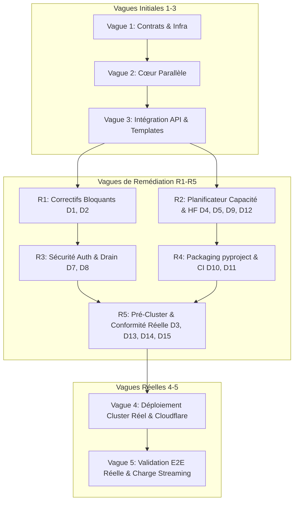

# Plan d'Exécution Multi-Agents : Plateforme d'Inférence Kubernetes + NVIDIA Dynamo + LiteLLM + Cloudflare

Ce document définit l'architecture organisationnelle, les contrats d'interface, l'arborescence du monorepo, le graphe de dépendances (DAG) et les instructions système pour une **équipe de 6 agents autonomes** chargée de construire, tester et déployer l'intégralité de la plateforme d'inférence distribuée.

---

## 0. État d'Avancement et Audit Post-Remédiation (2026-10-13)

Historique du dépôt : `2a782cc` (livraison initiale du squelette vagues 1–3) → `8759dd9` (remédiation R1–R4 sur défauts D1–D12) → arbre de travail actuel (ajouts majeurs : pipeline multi-clusters, console web, RBAC runtime). Les vagues 4 et 5 (cluster bare-metal réel & validation E2E non-mockée) n'ont pas encore été exécutées.

### Mise à jour R5 & Audit Complet (2026-10-15)

Le checkpoint des ajouts pipeline, passerelle, console web, workflow data/LoRA et
remédiations d'audit forensique est consolidé dans l'arbre actuel :
- **Remédiation R5 complétée** : DGD `nvidia.com/v1beta1` et `NixlConnector` (`D3`),
  cycle KEDA complet (`D13`), Jobs warmer épinglés par hostname avec attente
  bloquante sur tous les nœuds (`D14`), secrets `gateway/litellm-deployment.yaml`
  convertis en `secretKeyRef: inference-runtime` (`D15`), et validation `kubeconform v0.7.0`
  sur les CRDs officiels versionnés (`D11`).
- **Audit forensique complet (M1–M4)** : 43 défauts analysés dans
  [`docs/audit-defect-catalog.md`](docs/audit-defect-catalog.md), correctifs
  Critiques/Hauts appliqués dans l'arbre de travail, **18/18 tests PoC**
  (`tests/test_audit_defects_poc.py`) et **145/145 tests pytest** passants.
- **Plan de suivi & intégrations amont (2025–2026)** : voir
  [`docs/followup-plan.md`](docs/followup-plan.md) pour les actions pré-Vague 4
  (alignement du chemin de révision épinglée entre `loader/model_warmer.py` et
  `dynamo/templates/dgd-components.yaml.j2`, RBAC `jobs/status` dans
  `infra/data-workflow.yaml`), les mises à niveau d'intégrations vérifiées en
  ligne (`hf_xet`, Run:ai Model Streamer + cache `torch.compile`, LMCache + NIXL,
  Dynamo SLA Planner / Kubernetes Gateway API Inference Extension, LiteLLM + Redis),
  et le protocole d'exécution des Vagues 4 et 5.

Les constats historiques ci-dessous décrivent l'état initial avant R5.

### 1. Synthèse Exécutive

| Dimension | Statut | Commentaire |
|---|---|---|
| **Architecture & Structure Monorepo** | 🟢 Conforme | Structure propre, packaging `pyproject.toml` unifié, suppression des symlinks et `sys.path`. |
| **Contrat 1 : Auto-Tuner & VRAM** | 🟢 Conforme | Formules mathématiques exactes, support GQA/MLA, validation RFC 1123, contraintes de capacité respectées (HTTP 409). |
| **Contrat 2 : CRD Dynamo & Templates** | 🔴 Non conforme | **Défaut D3 non résolu** : syntaxe `nvidia.com/v1alpha1` et `spec.services` synthétique conservée ; drapeaux NIXL vLLM non conformes à l'opérateur officiel. `dynamo_crd.schema.json` assoupli artificiellement au lieu d'aligner les templates sur v1beta1. |
| **Contrat 3 : Synchronisation LiteLLM** | 🟢 Conforme | Suppression des mocks implicites, retries avec backoff exponentiel, échec bloquant la suppression Kubernetes. |
| **Sécurité & Authentification (D7)** | 🟡 Partiel | Auth Bearer & Cloudflare Access active sur l'API, mais clés en clair résiduelles dans `gateway/litellm-deployment.yaml`. |
| **Autoscaling KEDA (Wave 3)** | 🔴 Inopérant | Templates `keda-scaledobjects.yaml.j2` rédigés mais jamais appliqués par le réconciliateur lors d'un déploiement (D13). |
| **Pipeline Multi-Clusters & Web UI** | 🟢 Bonus / Avancé | Script `scripts/deploy_clusters.py`, RBAC runtime, images immuables par digest et console web `control-plane/api/web/`. |
| **Vagues 4 & 5 (Cluster réel & E2E)** | ⚪ Non démarrées | 100 % des tests reposent sur des mocks (`CONTROL_PLANE_MOCK=1`) ; aucun cluster réel ni intégration Kind n'a encore été validé. |

---

### 2. Audit Détaillé des Défauts (D1 à D12) & Vagues de Remédiation (R1 à R4)

| ID | Sév. | Défaut identifié dans le plan | Statut Réel | Évaluation de l'Implémentation | Agent |
|---|---|---|---|---|---|
| **D1** | 🔴 | Bascule silencieuse en mock & masquage d'erreurs LiteLLM | 🟢 Résolu | `K8sClient` et `LiteLLMSync` exigent `CONTROL_PLANE_MOCK=1` explicite (interdit in-cluster). `deregister_model` lève une exception et bloque la suppression K8s. | Agent 4 |
| **D2** | 🔴 | `--quantization=bf16/fp16` invalide | 🟢 Résolu | Séparation stricte dans `model_spec.schema.json` et `sla_planner.py` : `dtype` distinct de `quantization`. Les templates n'émettent `--quantization` que s'il est non-nul. | Agent 2, 3 |
| **D3** | 🔴 | Templates DGD non conformes au CRD réel de l'opérateur Dynamo | 🔴 Non Résolu | `dgd-disaggregated.yaml.j2` utilise toujours `nvidia.com/v1alpha1`, `spec.backend` et `spec.services`. Au lieu d'aligner le template sur `v1beta1` (`spec.components`), `dynamo_crd.schema.json` a été assoupli avec `"services": {"type": "object"}` pour faire passer les tests. | Agent 2 |
| **D4** | 🔴 | Planificateur sans contrainte de capacité (réplicas figés) | 🟢 Résolu | `SLAPlanner.plan` calcule les GPU requis et lève `InsufficientCapacityError` (mappé en HTTP 409). Le ratio P/D dérive du profil et `can_decode_reduce_tp` valide la VRAM de décodage. | Agent 3 |
| **D5** | 🟠 | Inventaire GPU codé en dur | 🟢 Résolu | `get_cluster_gpu_inventory` inspecte les nœuds réels, les labels GFD (`nvidia.com/gpu.product`, `nvidia.com/gpu.memory`) et soustrait les requêtes GPU des pods existants. | Agent 4 |
| **D6** | 🟠 | Warmer NVMe jamais lancé ; timeout readiness trop court | 🟢 Résolu | `DynamoReconciler.deploy_model` génère et attend la fin du Job `warmer-job.yaml.j2` (timeout 30 min). La readiness frontend passe également à 1800s. | Agent 3, 4 |
| **D7** | 🔴 | API sans authentification ; secrets en clair | 🟡 Partiel | `verify_auth` protège toutes les routes `/api/v1/*` via Bearer token ou en-têtes Cloudflare Access. En revanche, `gateway/litellm-deployment.yaml` contient toujours `sk-internal-litellm-master-key` et `litellm_secret` en clair. | Agent 1, 4 |
| **D8** | 🟠 | État en mémoire ; drain fixe de 15s | 🟢 Résolu | `reconcile_existing` recharge l'état des CRDs Kubernetes au démarrage du Control Plane. Le drain vérifie dynamiquement `get_running_requests_count` jusqu'à 120s. | Agent 4 |
| **D9** | 🟠 | Inspecteur HF imprécis (GQA, MLA, MoE) avec fallback silencieux | 🟢 Résolu | `HFInspector` lit `model.safetensors.index.json`, priorise `head_dim`, prend en compte `kv_lora_rank`/`qk_rope_head_dim` (MLA), et lève `ModelNotFoundError` (HTTP 404) sans fallback silencieux. | Agent 3 |
| **D10** | 🟡 | Packaging bricolé (symlink & sys.path) | 🟢 Résolu | Migration vers `pyproject.toml` avec configuration setuptools, package discoverable et suppression des manipulations de `sys.path`. | Agent 0 |
| **D11** | 🟡 | Tests mockés ; CI non alignée ; absence kubeconform/Kind | 🟡 Partiel | Docker builds, Ruff et Mypy intégrés en CI. Cependant, les tests E2E demeurent 100 % mockés, `kubeconform` et la validation Kind sont absents de la CI. | Agent 5, 0 |
| **D12** | 🟡 | Noms de déploiement non conformes RFC 1123 | 🟢 Résolu | `sanitize_deployment_name` et validation Pydantic `validate_name` appliquent l'expression régulière RFC 1123. | Agent 3 |
| **D13** | 🔴 | **Nouveau** — Autoscaling KEDA orphelin (Wave 3) | 🔴 Non Résolu | `keda-scaledobjects.yaml.j2` rédigé mais jamais appliqué dans `DynamoReconciler.deploy_model`. | Agent 4, 5 |
| **D14** | 🟠 | **Nouveau** — Piège du cache NVMe hostPath multi-nœuds | 🔴 Non Résolu | `warmer-job.yaml.j2` mono-pod ne préchauffe qu'un seul nœud sur un cluster multi-nœuds. À convertir en Job indexé ou DaemonSet. | Agent 3, 4 |
| **D15** | 🟡 | **Nouveau** — Secrets statiques dans `gateway/` | 🔴 Non Résolu | Clés en clair dans `gateway/litellm-deployment.yaml` à remplacer par `secretKeyRef: inference-runtime`. | Agent 1, 4 |

---

### 3. Écarts Critiques & Dette Technique

#### 1. Incompatibilité du CRD Dynamo avec l'Opérateur Réel (Défaut D3)
Le modèle de template actuel `dgd-disaggregated.yaml.j2` génère :
```yaml
apiVersion: nvidia.com/v1alpha1
kind: DynamoGraphDeployment
spec:
  backend: vllm
  model: "{{ model_id }}"
  services:
    Frontend: ...
    PrefillWorker: ...
    DecodeWorker: ...
```
Or, selon les spécifications NVIDIA Dynamo v1.5+ ([docs/architecture-audit.md](docs/architecture-audit.md)) :
* La version de stockage canonique est `nvidia.com/v1beta1`.
* Le bloc `spec.services` a été remplacé par une liste typée `spec.components` où chaque composant définit un rôle (`frontend`, `prefill`, `decode`), des réplicas, un `providerOverride` Grove et un conteneur `main` exécutant `python3 -m dynamo.vllm`.
* Le transfert de KV-Cache via RDMA / NIXL s'effectue via l'argument :
  `--kv-transfer-config '{"kv_connector":"NixlConnector", "kv_role":"kv_producer|kv_consumer", "kv_buffer_device":"cuda"}'`
  et non par des variables d'environnement arbitraires `VLLM_KV_CACHE_TRANSFER_*`. Le Frontend exige également `DYN_ROUTER_MODE=kv`.

> [!WARNING]
> Sur un cluster réel où l'opérateur officiel NVIDIA Dynamo est installé, les manifestes générés par `DynamoReconciler` seront immédiatement rejetés à l'admission ou ignorés par le contrôleur.

#### 2. Autoscaling KEDA Orphelin (Wave 3 / Défaut D13)
Bien que `monitoring/keda-scaledobjects.yaml.j2` cible correctement le `DynamoGraphDeploymentScalingAdapter` (`v1beta1`), ce template n'est jamais appelé ni appliqué dans la boucle de réconciliation de `DynamoReconciler.deploy_model`. Aucun `ScaledObject` n'est créé lors du déploiement d'un modèle, et aucun n'est nettoyé lors du `DELETE`.

#### 3. Piège du Cache NVMe hostPath en Multi-Nœuds (D6 / Wave 4 / Défaut D14)
Le Job de pré-chargement `loader/warmer-job.yaml.j2` est un Job Kubernetes simple (1 seul pod). Sur un cluster multi-nœuds, il n'alimente que le disque local du nœud sur lequel le pod warmer a été programmé. Lorsque les pods Prefill et Decode sont ensuite planifiés par Grove/KAI sur d'autres nœuds, leur répertoire `/mnt/nvme/model-cache` sera vide, forçant un re-téléchargement Hugging Face au démarrage. Le job doit être converti en **Job Indexé** (`completionMode: Indexed` avec anti-affinité de pod) ou en **DaemonSet** ciblant tous les nœuds GPU étiquetés.

#### 4. Secrets en Clair Résiduels dans le Dépôt (D7 / Défaut D15)
Bien que `scripts/deploy_clusters.py` remplace dynamiquement les variables d'environnement par des références `secretKeyRef: inference-runtime`, le fichier statique `gateway/litellm-deployment.yaml` contient encore des mots de passe en dur (`sk-internal-litellm-master-key`, `litellm_secret`). Il convient de le convertir en template ou en fichier `.example.yaml` et d'injecter les secrets via Kubernetes Secret.

---

### 4. Analyse des Nouveaux Développements (Non Prévus Initialement)

Entre le commit `8759dd9` et l'état de l'arbre de travail, des fonctionnalités majeures ont été ajoutées et doivent être formalisées dans le plan :

1. **Pipeline de Déploiement Multi-Clusters Indépendants (`deploy/`, `scripts/deploy_clusters.py`, `.github/workflows/deploy.yaml`)** :
   - Publication centralisée d'images immuables par digest SHA-256 (`repository@sha256:...`).
   - Script d'orchestration `scripts/deploy_clusters.py` avec vérifications préalables strictes (preflight checks, conformité des contextes, dry-run côté serveur, séquence ordonnée Gateway puis Control Plane).
   - Suite de tests unitaires dédiée (`tests/test_cluster_deployment.py`, 13 tests validant le comportement hors cluster).

2. **RBAC Runtime (`infra/control-plane-rbac.yaml`)** :
   - ServiceAccount, ClusterRole et ClusterRoleBinding attribuant les permissions granulaires nécessaires au Control Plane (`dynamographdeployments`, `endpointslice`, `nodes`, `jobs`, `secrets`).

3. **Console Web du Control Plane (`control-plane/api/web/`)** :
   - Interface monopage moderne (HTML5 sémantique, CSS accessible avec contrastes et thèmes adaptés, JS natif sans framework lourd).
   - Gestion de l'authentification Bearer token avec conservation en mémoire.
   - Formulaire de déploiement connecté à l'Auto-Tuner, visualisation de l'inventaire des pools GPU et suivi du statut des déploiements en temps réel.
   - Montage direct dans FastAPI sous `/` et `/assets`.
   - Suite de tests unitaires dédiée (`tests/test_web_console.py`, 12 tests).

---

### 5. État des Tests et Qualité

* **Pytest** : **39/39 tests passent avec succès** :
  - `tests/test_vram_calculator.py` : 7 tests (formules mathématiques, GQA/MLA, contraintes TP, divisibilité).
  - `tests/test_crd_rendering.py` : 2 tests (rendu Jinja2 et validation de schéma).
  - `tests/test_cluster_deployment.py` : 13 tests (validation du déploiement multi-clusters, dry-run, digest).
  - `tests/test_web_console.py` : 12 tests (routage web, assets statiques, sécurité, formulaires).
  - `tests/e2e_deployment_flow.py` : 5 tests (cycle de vie complet mocké).
* **Mypy** : 0 erreur sur le module `control-plane`.
* **Ruff** : `ruff check control-plane` passe sans anomalie (imports triés, code formaté).

---

### 6. Feuille de Route Recommandée pour les Vagues 4 & 5 (Vague R5 Pré-Cluster)

Avant d'initier le déploiement sur cluster réel (Vague 4) et les tests de charge en streaming (Vague 5), les actions suivantes sont requises dans une vague **R5 Pré-Cluster** :

1. **Résoudre D3** : Aligner les templates Jinja2 (`dgd-disaggregated.yaml.j2` et `dgd-aggregated.yaml.j2`) et le schéma `contracts/dynamo_crd.schema.json` sur `nvidia.com/v1beta1` (`components[]` avec conteneur `main`, `--disaggregation-mode`, `--kv-transfer-config` NixlConnector, `DYN_ROUTER_MODE=kv`).
2. **Intégrer KEDA (D13)** : Appliquer le template `keda-scaledobjects.yaml.j2` dans `DynamoReconciler.deploy_model` et assurer son nettoyage lors de `delete_model`.
3. **Corriger le Warmer Multi-Nœuds (D14)** : Transformer `loader/warmer-job.yaml.j2` en Job indexé ou DaemonSet pour peupler le NVMe de tous les nœuds GPU cibles.
4. **Assainir les Secrets Statiques (D15)** : Renommer `gateway/litellm-deployment.yaml` en `.example.yaml` et injecter les credentials via `secretKeyRef: inference-runtime`.
5. **Validation CI Kind & Kubeconform (D11)** : Ajouter dans la CI GitHub Actions la validation `kubeconform` (avec le CRD officiel Dynamo v1beta1) et un cluster éphémère Kind exécutant le cycle de déploiement.
6. **Commit des Nouveaux Développements** : Valider et commiter le pipeline multi-clusters et la console web dans `main`.

---

## 1. Topologie de l'Équipe d'Agents et Responsabilités

Chaque agent possède un périmètre d'écriture strict dans le monorepo afin d'éviter tout conflit de fusion lors des exécutions parallèles.

| **ID Agent** | **Rôle** | **Périmètre Monorepo** | **Responsabilités Clés** |
|---|---|---|---|
| **Agent 0** | **Lead Architect & Orchestrator** | `/`, `contracts/`, `.github/` | Définit les schémas Pydantic/OpenAPI partagés, orchestre le DAG d'exécution, valide les Quality Gates, gère le packaging `pyproject.toml` et fusionne les branches. |
| **Agent 1** | **Infra, K8s & Cloudflare Network** | `infra/`, `scripts/`, `deploy/` | Automatise l'installation OS/GPU, K3s, [NVIDIA GPU Operator](https://docs.nvidia.com/datacenter/cloud-native/gpu-operator/latest/), Ingress-NGINX, [Cloudflare Tunnel et ExternalDNS](https://itnext.io/exposing-kubernetes-apps-to-the-internet-with-cloudflare-tunnel-ingress-controller-and-e30307c0fcb0), **Cloudflare Access** devant le Control Plane, et orchestre le pipeline de déploiement multi-clusters (`deploy_clusters.py`). |
| **Agent 2** | **NVIDIA Dynamo & Disaggregated Serving** | `dynamo/` | Déploie [NVIDIA Dynamo Platform](https://docs.nvidia.com/dynamo/) (CRDs v1beta1, Grove, KAI Scheduler), conçoit les templates `DynamoGraphDeployment` v1beta1 (Prefill/Decode avec NixlConnector) et configure le transfert KV-Cache RDMA/NVLink. |
| **Agent 3** | **Auto-Tuner & Model Loader Engine** | `control-plane/autotuner/`, `loader/` | Inspecte les métadonnées Hugging Face / S3 (`config.json`, `safetensors.index.json`), calcule la VRAM exacte (poids + KV-Cache GQA/MLA), déduit TP/PP/Quantization/Ratio P-D avec contrainte de capacité stricte et gère le pré-chargement multi-nœuds sur cache NVMe. |
| **Agent 4** | **Control Plane API & LiteLLM Sync** | `control-plane/api/`, `gateway/` | Développe le WebService FastAPI et la console web SPA, réconcilie les CRDs Kubernetes et les ScaledObjects KEDA, surveille les `EndpointSlices` et synchronise à chaud les modèles dans [LiteLLM Proxy](https://docs.litellm.ai/docs/proxy/model_management) (`/model/new`, `/model/delete`). |
| **Agent 5** | **Autoscaling (KEDA), Observabilité & QA** | `monitoring/`, `tests/` | Configure Prometheus + DCGM Exporter, conçoit les `ScaledObject` KEDA ciblant le `DynamoGraphDeploymentScalingAdapter`, maintient la suite de tests unitaires/E2E et valide la qualité en CI (Kind, Ruff, Mypy). |

---

## 2. Arborescence Cible du Monorepo

```
ai-inference-platform/
├── pyproject.toml                    # [Agent 0] Packaging unifié Python (remplace symlink et sys.path)
├── contracts/                        # [Agent 0] Contrats d'interfaces figés entre agents
│   ├── model_spec.schema.json        # Entrée/Sortie du calculateur Auto-Tuner (Contrat 1)
│   ├── dynamo_crd.schema.json        # Schéma de validation DynamoGraphDeployment v1beta1 (Contrat 2)
│   └── control_plane_openapi.yaml    # Spécification REST du WebService
├── scripts/                          # [Agent 1] Scripts d'initialisation et d'orchestration
│   ├── bootstrap_inference_cluster.sh# Bootstrap bare-metal Ubuntu (K3s, GPU Operator, RDMA)
│   └── deploy_clusters.py            # [Ajout] Déploiement multi-clusters (preflight, digest SHA-256)
├── deploy/                           # [Ajout] Manifestes et contextes des clusters cibles
├── infra/                            # [Agent 1] Manifests K8s d'infrastructure
│   ├── control-plane-rbac.yaml       # [Ajout] RBAC runtime du Control Plane
│   ├── gpu-operator/                 # Configuration GPU Operator
│   ├── network-rdma/                 # Configuration NicClusterPolicy RoCE / InfiniBand
│   ├── storage-nvme/                 # StorageClass local et PVC pour /mnt/nvme/model-cache
│   └── cloudflare/                   # cloudflared (2 réplicas) + external-dns + ingress-nginx
├── dynamo/                           # [Agent 2] Templates & CRDs NVIDIA Dynamo v1beta1
│   ├── helm-values/                  # Configuration Dynamo Platform, Grove et KAI Scheduler
│   └── templates/
│       ├── dgd-disaggregated.yaml.j2 # Template v1beta1 Prefill/Decode séparés (Grove + NIXL)
│       └── dgd-aggregated.yaml.j2    # Template v1beta1 standard monobloc
├── loader/                           # [Agent 3] Pré-chargement NVMe multi-nœuds
│   ├── Dockerfile                    # Image de téléchargement rapide
│   ├── warmer-job.yaml.j2            # [R5] Job K8s indexé / DaemonSet multi-nœuds
│   └── model_warmer.py               # Téléchargement parallèle HF/S3 avec hf_transfer -> NVMe
├── control-plane/                    # [Agent 3 & Agent 4] Backend Python FastAPI + UI
│   ├── Dockerfile                    # Image de production du Control Plane
│   ├── autotuner/                    # [Agent 3] Calculateur VRAM, TP, PP, P/D Ratio
│   │   ├── hf_inspector.py           # Inspection safetensors/config HF sans téléchargement
│   │   ├── vram_calculator.py        # Calcul VRAM exact (poids, GQA/MLA, KV-cache)
│   │   └── sla_planner.py            # Planificateur SLA avec contraintes de capacité
│   └── api/                          # [Agent 4] Serveur FastAPI + K8s Watcher + LiteLLM
│       ├── main.py                   # Endpoints REST, cycle de vie, authentification
│       ├── k8s_client.py             # Client asynchrone Kubernetes (CRD, EndpointSlice, GFD)
│       ├── dynamo_reconciler.py      # Réconciliateur Dynamo DGD + KEDA ScaledObjects
│       ├── litellm_sync.py           # Synchroniseur dynamique LiteLLM avec retries
│       └── web/                      # [Ajout] Console Web SPA (HTML/CSS/JS natif)
├── gateway/                          # [Agent 4] Configuration LiteLLM + Postgres + Redis
│   ├── litellm-deployment.yaml       # Déploiement LiteLLM Proxy (sécurisé via Secret)
│   └── config.yaml                   # Configuration du proxy LiteLLM
├── monitoring/                       # [Agent 5] KEDA, Prometheus, Grafana
│   ├── keda-scaledobjects.yaml.j2    # ScaledObjects KEDA ciblant DGDScalingAdapter
│   └── prometheus-rules.yaml         # Alertes et règles d'enregistrement DCGM / vLLM
└── tests/                            # [Agent 5] Suite de tests unitaires, rendus et E2E
    ├── conftest.py                   # Fixtures pytest partagées
    ├── test_vram_calculator.py       # Validation formules VRAM, divisibilité H_kv % TP
    ├── test_crd_rendering.py         # Validation rendu Jinja2 et schémas JSON
    ├── test_cluster_deployment.py    # [Ajout] Validation pipeline multi-clusters
    ├── test_web_console.py           # [Ajout] Validation endpoints et assets console web
    └── e2e_deployment_flow.py        # Validation cycle de vie complet (mocké / Kind)
```

---

## 3. Contrats d'Interface Techniques (Handshakes Inter-Agents)

### Contrat 1 : Sortie de l'Auto-Tuner (Agent 3 -> Agent 2 & Agent 4)

L'Agent 3 expose la fonction pure `compute_deployment_plan(request: DeployRequest, cluster_gpu_inventory: ClusterInventory) -> DeploymentPlan` conforme à `contracts/model_spec.schema.json` :

```json
{
  "model_id": "meta-llama/Llama-3.3-70B-Instruct",
  "deployment_name": "llama-3-3-70b-instruct",
  "serving_mode": "disaggregated",
  "dtype": "bfloat16",
  "quantization": "fp8",
  "max_model_len": 32768,
  "gpu_memory_utilization": 0.90,
  "estimated_vram_gb_per_replica": 78.4,
  "prefill_clique": {
    "replicas": 2,
    "tensor_parallel_size": 4,
    "pipeline_parallel_size": 1,
    "gpu_sku": "NVIDIA-H100-80GB",
    "max_num_batched_tokens": 16384,
    "enable_chunked_prefill": true
  },
  "decode_clique": {
    "replicas": 4,
    "tensor_parallel_size": 2,
    "pipeline_parallel_size": 1,
    "gpu_sku": "NVIDIA-H100-80GB",
    "max_num_seqs": 256
  },
  "kv_cache_transfer": {
    "protocol": "rdma",
    "engine": "nixl",
    "backend": "UCX"
  }
}
```

**Règles du Contrat 1 :**
* `dtype` ∈ {`auto`, `bfloat16`, `float16`} → transmis à `--dtype`.
* `quantization` ∈ {`null`, `fp8`, `awq`, `gptq`} → transmis à `--quantization` uniquement s'il n'est pas `null` (résout D2).
* Clé `engine` en minuscules (`nixl`).
* `deployment_name` validé selon l'expression régulière RFC 1123 (`^[a-z]([-a-z0-9]{0,61}[a-z0-9])?$`).
* **Contrainte de capacité** : $\sum (\text{replicas} \times TP \times PP) \le GPU_{\text{disponibles}}$. Si la capacité est insuffisante, levée immédiate de `InsufficientCapacityError` (HTTP 409).
* La clique de décodage ne peut réduire son TP (`tp_size // 2`) que si la VRAM unitaire le permet (`can_decode_reduce_tp`).

---

### Contrat 2 : Rendu du CRD `DynamoGraphDeployment` v1beta1 (Agent 2 -> Agent 4)

L'Agent 2 fournit les gabarits Jinja2 produisant un manifeste conforme au schéma canonique **`nvidia.com/v1beta1`** de NVIDIA Dynamo v1.5+ :

```yaml
apiVersion: nvidia.com/v1beta1
kind: DynamoGraphDeployment
metadata:
  name: "{{ deployment_name }}"
  namespace: "{{ namespace | default('dynamo-workloads') }}"
  labels:
    app.kubernetes.io/managed-by: dynamo-control-plane
    dynamo.nvidia.com/serving-mode: disaggregated
  annotations:
    nvidia.com/grove-update-strategy: RollingRecreate
spec:
  backendFramework: vllm
  components:
    - name: frontend
      type: frontend
      replicas: 2
      podTemplate:
        spec:
          containers:
            - name: main
              image: "{{ dynamo_runtime_image }}"
              env:
                - name: DYN_ROUTER_MODE
                  value: "kv"
              ports:
                - name: http
                  containerPort: 8000

    - name: prefill
      type: prefill
      replicas: {{ prefill_clique.replicas }}
      providerOverride:
        apiVersion: grove.io/v1alpha1
        value:
          spec:
            minAvailable: 1
      podTemplate:
        spec:
          volumes:
            - name: model-cache
              hostPath:
                path: /mnt/nvme/model-cache
                type: DirectoryOrCreate
            - name: dshm
              emptyDir:
                medium: Memory
                sizeLimit: 32Gi
          containers:
            - name: main
              image: "{{ dynamo_runtime_image }}"
              workingDir: /workspace/examples/backends/vllm
              command:
                - python3
                - -m
                - dynamo.vllm
              args:
                - --model={{ model_id }}
                - --disaggregation-mode=prefill
                - --tensor-parallel-size={{ prefill_clique.tensor_parallel_size }}
                - --dtype={{ dtype }}
                
                - --quantization={{ quantization }}
                
                - --max-model-len={{ max_model_len }}
                - --max-num-batched-tokens={{ prefill_clique.max_num_batched_tokens }}
                - --gpu-memory-utilization={{ gpu_memory_utilization }}
                - --enable-chunked-prefill=true
                - --kv-transfer-config={"kv_connector":"NixlConnector","kv_role":"kv_producer","kv_buffer_device":"cuda"}
              resources:
                limits:
                  nvidia.com/gpu: {{ prefill_clique.tensor_parallel_size }}

    - name: decode
      type: decode
      replicas: {{ decode_clique.replicas }}
      podTemplate:
        spec:
          volumes:
            - name: model-cache
              hostPath:
                path: /mnt/nvme/model-cache
                type: DirectoryOrCreate
            - name: dshm
              emptyDir:
                medium: Memory
                sizeLimit: 32Gi
          containers:
            - name: main
              image: "{{ dynamo_runtime_image }}"
              workingDir: /workspace/examples/backends/vllm
              command:
                - python3
                - -m
                - dynamo.vllm
              args:
                - --model={{ model_id }}
                - --disaggregation-mode=decode
                - --tensor-parallel-size={{ decode_clique.tensor_parallel_size }}
                - --dtype={{ dtype }}
                
                - --quantization={{ quantization }}
                
                - --max-model-len={{ max_model_len }}
                - --gpu-memory-utilization={{ gpu_memory_utilization }}
                - --kv-transfer-config={"kv_connector":"NixlConnector","kv_role":"kv_consumer","kv_buffer_device":"cuda"}
              resources:
                limits:
                  nvidia.com/gpu: {{ decode_clique.tensor_parallel_size }}
```

---

### Contrat 3 : Synchronisation Dynamique LiteLLM (Agent 4)

Dès que l'`EndpointSlice` du service frontend (`{{ deployment_name }}-frontend`) passe à `Ready=true`, l'Agent 4 exécute l'enregistrement REST vers LiteLLM Proxy :

```http
POST http://litellm-service.ai-gateway.svc.cluster.local:4000/model/new
Authorization: Bearer <LITELLM_MASTER_KEY>
Content-Type: application/json

{
  "model_name": "llama-3-3-70b-instruct",
  "litellm_params": {
    "model": "openai/meta-llama/Llama-3.3-70B-Instruct",
    "api_base": "http://llama-3-3-70b-instruct-frontend.dynamo-workloads.svc.cluster.local:8000/v1",
    "api_key": "internal-dynamo-key",
    "rpm": 1000,
    "timeout": 600
  },
  "model_info": {
    "id": "dgd-llama-3-3-70b-instruct",
    "mode": "chat",
    "supports_function_calling": true
  }
}
```

**Règles du Contrat 3 :**
* Aucun fallback mock silencieux : un échec d'enregistrement ou de suppression lève une exception et bloque la réconciliation.
* Retries avec backoff exponentiel (3 tentatives) lors de la synchronisation réseau.
* La suppression Kubernetes d'un modèle n'est autorisée **que si** le retrait dans LiteLLM (`/model/delete`) a réussi et que les requêtes en cours ont été drainées.
* `LITELLM_MASTER_KEY` est injectée obligatoirement par Secret Kubernetes.

---

## 4. Plan d'Exécution Global et Vagues de Remédiation

### 4.1 Graphe des Vagues de Développement & Remédiation



---

### 4.2 Spécification de la Vague R5 (Pré-Cluster & Conformité Réelle)

La vague **R5** constitue le point d'arrêt qualité indispensable avant de lancer le bootstrap sur machines bare-metal.

| Vague | Agents | Tâches Assignées | Défauts Traités | Quality Gate & Critère d'Acceptation |
|---|---|---|---|---|
| **R5 : Pré-Cluster & Conformité Réelle** | Agent 0, 1, 2, 3, 4, 5 | **Agent 2** : Refondre `dgd-disaggregated.yaml.j2` et `dgd-aggregated.yaml.j2` en `nvidia.com/v1beta1` (`components[]`, conteneur `main`, flags `--kv-transfer-config` et `DYN_ROUTER_MODE=kv`). Aligner strictement `contracts/dynamo_crd.schema.json`.<br>**Agent 4 & 5** : Intégrer l'application et la suppression des `ScaledObject` KEDA dans `DynamoReconciler.deploy_model` et `delete_model`.<br>**Agent 3 & 4** : Convertir `loader/warmer-job.yaml.j2` en Job indexé multi-nœuds ou DaemonSet NVMe.<br>**Agent 1 & 4** : Remplacer les secrets en clair de `gateway/litellm-deployment.yaml` par `secretKeyRef: inference-runtime`.<br>**Agent 0 & 5** : Intégrer `kubeconform` (avec le CRD v1beta1) et un test Kind en CI. Commiter les modules pipeline et web UI. | D3, D7 (reliquat), D11, D13, D14, D15 | 1. Validation syntaxique `kubeconform -schema-location ...` à 100 % sur les manifestes DGD v1beta1 rendus.<br>2. Test unitaire prouvant la création et la suppression conjointe du DGD et du `ScaledObject` KEDA.<br>3. `git grep -E 'sk-internal\|litellm_secret'` ne renvoie aucun résultat dans les manifests.<br>4. Job warmer généré avec un pod par nœud GPU cible.<br>5. CI complète verte avec Kind. |

---

### 4.3 Vagues 4 et 5 (Production & Validation Réelle)

| Vague | Agents Actifs | Tâches Réelles | Critère de Validation (Quality Gate) |
|---|---|---|---|
| **Vague 4 : Déploiement Cluster & DNS** | Agent 1, Agent 2, Agent 4 | Exécution de `scripts/deploy_clusters.py` sur les clusters cibles : validation GPU Operator, pilotes RDMA/RoCE, installation Dynamo Platform v1beta1, Ingress-NGINX, Cloudflare Tunnel et passerelle LiteLLM. | `kubectl get pods -A` affiche 100 % des pods en état `Running` ; `https://llm.<domaine>/health/readiness` et `https://control.<domaine>/health` répondent `200 OK` via Cloudflare Access. |
| **Vague 5 : Recette E2E Réelle & Tir de Charge** | Agent 5, Agent 0 | Déploiement d'un modèle réel (`POST /api/v1/models/deploy`), vérification du pré-chargement NVMe sur tous les nœuds, instanciation DGD v1beta1, enregistrement LiteLLM, et tir de charge streaming SSE. Test de résilience et retrait sans erreur HTTP 502. | Zéro requête perdue lors de l'enregistrement et du retrait du modèle ; TTFT et TPOT conformes aux SLAs sur GPU physiques. |

---

## 5. Algorithme Détaillé de l'Auto-Tuner (VRAM, GQA, MLA & Capacité)

L'Agent 3 implémente les formules mathématiques exactes suivantes dans `control-plane/autotuner/vram_calculator.py` et `sla_planner.py` :

### 1. Mémoire des Poids ($M_{\text{weights}}$)
$$M_{\text{weights}} = N_{\text{params}} \times B_{\text{dtype}} \times 1.05$$
* $B_{\text{dtype}} = 2.0$ octets (BF16 / FP16), $1.0$ octet (FP8), ou $0.55$ octet (AWQ / INT4 avec overhead de quantification).
* $N_{\text{params}}$ est extrait en priorité du champ `metadata.total_size` de `model.safetensors.index.json` (inclut nativement les architectures MoE). En cas d'absence, calcul déduit de `config.json` avec support de GQA ($2 \cdot h^2 + 2 \cdot h \cdot H_{\text{kv}} \cdot D_{\text{head}}$ par couche d'attention).

### 2. Mémoire du KV-Cache par Token ($M_{\text{kv\_token}}$)
* **Architectures Standards et GQA** :
  $$M_{\text{kv\_token}} = 2 \times L \times H_{\text{kv}} \times D_{\text{head}} \times B_{\text{kv\_dtype}}$$
  avec $D_{\text{head}}$ extrait en priorité de `config.json` (ou $h / H_{\text{attn}}$), et $B_{\text{kv\_dtype}} = 1.0$ (FP8) ou $2.0$ (FP16).
* **Architectures MLA (Multi-Head Latent Attention - DeepSeek)** :
  $$M_{\text{kv\_token}} = L \times (\text{kv\_lora\_rank} + \text{qk\_rope\_head\_dim}) \times B_{\text{kv\_dtype}}$$

### 3. Empreinte Totale et Sélection de $TP \in \{1, 2, 4, 8\}$
$$M_{\text{total}} = \frac{M_{\text{weights}} + (M_{\text{kv\_token}} \times C_{\text{max}} \times B_{\text{seq}}) + M_{\text{cuda\_graphs}}}{\text{gpu\_memory\_utilization}}$$
Le degré de parallélisme $TP$ est le plus petit entier dans $\{1, 2, 4, 8\}$ satisfaisant :
$$TP \times \text{VRAM}_{\text{GPU}} \ge M_{\text{total}} \quad \text{et} \quad H_{\text{kv}} \pmod{TP} = 0$$

### 4. Dimensionnement des Réplicas et Contraintes de Capacité
* Le nombre de GPU requis pour une clique $c$ est : $GPU_c = \text{replicas}_c \times TP_c \times PP_c$.
* Contrainte stricte de cluster : $\sum_c GPU_c \le GPU_{\text{disponibles}}$.
* Si le modèle ne tient pas sur les GPU disponibles, `InsufficientCapacityError` est levée immédiatement.
* La réduction de $TP$ sur la clique decode (`decode_tp = tp // 2`) n'est autorisée que si $M_{\text{total}}(\text{decode\_tp}) \le \text{decode\_tp} \times \text{VRAM}_{\text{GPU}}$.

---

## 6. Prompts Système Prêts à l'Emploi pour les Agents

### Prompt — Agent 1 (Infra, K8s & Cloudflare)
> Tu es l'Agent Infrastructure, Réseau Kubernetes et Déploiement Multi-Clusters. Ton périmètre exclusif est `infra/`, `scripts/` et `deploy/`. Tu maintiens les scripts bare-metal (`bootstrap_inference_cluster.sh`), l'orchestrateur multi-clusters (`deploy_clusters.py`), les charts Helm (GPU Operator, Network Operator RDMA, Ingress-NGINX) et Cloudflare Tunnel (`cloudflared`). Protège impérativement `control.<domaine>` par Cloudflare Access (Zero Trust avec Service Token). Ne commite aucun secret en clair dans `gateway/` ou `infra/` : utilise des références `secretKeyRef: inference-runtime`.

### Prompt — Agent 2 (NVIDIA Dynamo Specialist)
> Tu es l'Agent spécialiste NVIDIA Dynamo et Kubernetes CRDs. Ton périmètre exclusif est `dynamo/`. Tu dois concevoir les templates Jinja2 (`dgd-disaggregated.yaml.j2`, `dgd-aggregated.yaml.j2`) en respectant strictement le schéma canonique **`nvidia.com/v1beta1`** de Dynamo v1.5+. Utilise `spec.components` avec conteneur `main` exécutant `python3 -m dynamo.vllm`, injecte les arguments `--disaggregation-mode prefill|decode`, configure NIXL via `--kv-transfer-config` et positionne `DYN_ROUTER_MODE=kv`. Ne rétrograde jamais vers `v1alpha1` et n'assouplis pas les schémas dans `contracts/`.

### Prompt — Agent 3 (Auto-Tuner & Model Loader)
> Tu es l'Agent responsable du dimensionnement mathématique des modèles et du pré-chargement NVMe. Ton périmètre exclusif est `control-plane/autotuner/` et `loader/`. Implémente l'inspection sans téléchargement depuis HF (`safetensors.index.json` et `config.json`), calcule la VRAM exacte (GQA, MLA, MoE) et applique la contrainte de capacité stricte du cluster (lève `InsufficientCapacityError` en cas de dépassement). Dans `loader/`, fournis un Job K8s indexé (`completionMode: Indexed` avec anti-affinité de pod) ou un DaemonSet pour garantir que le cache `/mnt/nvme/model-cache` est peuplé sur **tous** les nœuds GPU cibles avant le démarrage des pods Dynamo.

### Prompt — Agent 4 (Control Plane API & LiteLLM Sync)
> Tu es l'Agent Backend Control Plane & Passerelle LiteLLM. Ton périmètre exclusif est `control-plane/api/` et `gateway/`. Tu maintiens l'API FastAPI et la console Web SPA (`control-plane/api/web/`). Dans `dynamo_reconciler.py`, orchestre la séquence complète : 1) Exécuter et attendre la complétion du Job warmer multi-nœuds, 2) Appliquer le CRD DGD v1beta1, 3) Rendre et appliquer le `ScaledObject` KEDA (`keda-scaledobjects.yaml.j2`), 4) Surveiller l'`EndpointSlice` frontend et enregistrer le modèle dans LiteLLM Proxy avec retries exponentiels. Lors d'un `DELETE`, effectue le retrait LiteLLM, draine les requêtes actives, puis supprime le `ScaledObject` et le DGD. Exige une authentification Bearer ou Cloudflare Access sur `/api/v1/*`.

### Prompt — Agent 5 (Autoscaling KEDA & QA E2E)
> Tu es l'Agent Observabilité, Autoscaling KEDA et Assurance Qualité. Ton périmètre exclusif est `monitoring/` et `tests/`. Crée les définitions `ScaledObject` KEDA ciblant le `DynamoGraphDeploymentScalingAdapter` (`nvidia.com/v1beta1`) pour scaler indépendamment Prefill (requêtes en attente) et Decode (saturation KV-Cache). Maintiens la suite de tests `pytest` et assure une validation rigoureuse en CI : exécution de `kubeconform` avec les schémas officiels Dynamo v1beta1, vérifications `ruff` et `mypy`, et tests d'intégration automatisés sur cluster Kind éphémère.