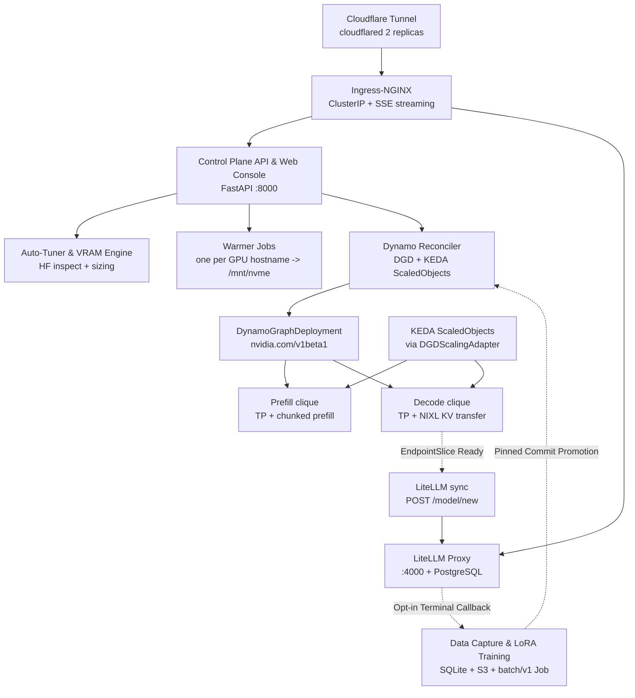

# Architecture

## System overview

## Components

| Component | Code | Role |
|---|---|---|
| Control Plane API | `control-plane/api/main.py` | REST + SPA at `/`, reconcile-on-startup, deploy/delete orchestration |
| Auth & Setup | `control-plane/api/auth.py`, `__main__.py` | Bearer tokens, Argon2id admin login, SQLite WAL sessions, CSRF + rate limits, interactive setup |
| K8s client & controls | `control-plane/api/k8s_client.py`, `k8s_controls.py` | Async CRUD for DGDs, Jobs, ScaledObjects, EndpointSlices, GPU inventory, pod logs/eviction, and component scaling |
| Reconciler | `control-plane/api/dynamo_reconciler.py` | Warmer → DGD → KEDA → EndpointSlice watch → LiteLLM; graceful teardown |
| LiteLLM sync | `control-plane/api/litellm_sync.py` | `POST /model/new` / `/model/delete` (idempotent 404) with 3-attempt exponential backoff |
| HF inspector | `control-plane/autotuner/hf_inspector.py` | Offline verified profiles + live `config.json` / `safetensors.index.json` reads |
| VRAM calculator | `control-plane/autotuner/vram_calculator.py` | Weight/KV/total VRAM math, GQA/MLA support, TP/PP selection with `H_kv` & `H_q` divisibility |
| SLA planner | `control-plane/autotuner/sla_planner.py` | Profile → replicas, P/D ratio, GPU catalog fallback, capacity gate (`InsufficientCapacityError` → 409) |
| Model warmer | `loader/model_warmer.py` | Parallel snapshot download into `/mnt/nvme/model-cache/hub/models--...` |
| Metrics | `control-plane/api/metrics.py` | Prometheus-backed usage snapshot + fail-closed drain checks |
| Data & Fine-Tuning | `control-plane/api/data_*.py`, `training*.py`, `training/train.py`, `gateway/data_capture.py` | Opt-in event capture, human review, immutable JSONL splits, single-GPU LoRA SFT, and pinned-revision promotion |

## Namespaces

| Namespace | Contents |
|---|---|
| `dynamo-control-plane` | Control Plane Deployment + Service, `inference-runtime` Secret, optional `inference-data` PVC, RBAC (`infra/control-plane-rbac.yaml`) |
| `dynamo-workloads` | Warmer Jobs, `DynamoGraphDeployment`s, KEDA ScaledObjects, `hf-token-secret` |
| `ai-gateway` | LiteLLM Proxy, `litellm-config` ConfigMap, Postgres StatefulSet, `inference-runtime` Secret |
| `inference-training` | Opt-in single-GPU LoRA training Jobs, `training-worker` ServiceAccount, `training-controller` Role, `ResourceQuota` (`infra/data-workflow.yaml`) |
| `monitoring` | `PrometheusRule` alerts/recording rules; Prometheus + KEDA installed separately |
| `ingress-nginx` / `cloudflare` | Internal ClusterIP Ingress-NGINX, cross-namespace `ExternalName` Services, `cloudflared` (2 replicas), and ExternalDNS |

## Deploy lifecycle

1. `POST /api/v1/models/deploy` → inventory (`get_cluster_gpu_inventory`) →
   `SLAPlanner.plan` (Contract 1).
2. `get_target_gpu_nodes` selects Ready, schedulable GPU hostnames matching the
   plan's SKU and per-pod GPU requirement.
3. One warmer Job per hostname is applied and awaited (30 min timeout each). Any
   failure aborts the deploy.
4. DGD (`nvidia.com/v1beta1`, `spec.components`) is applied; for disaggregated
   plans the two KEDA ScaledObjects are applied.
5. Background task polls the `<name>-frontend` EndpointSlice (up to 1800 s),
   then `register_model` in LiteLLM. Status becomes `running`.
6. `DELETE /api/v1/models/{name}` → `deregister_model` (HTTP 404 is treated as
   already absent; other failures **block** deletion) → gateway propagation delay
   (15 s default) → dynamic drain (poll `num_requests_running` until 0, max 120 s) →
   delete ScaledObjects → delete DGD.

State is recovered from cluster CRs on startup (`reconcile_existing`); the
in-memory cache is only a status overlay. For planned architecture evolutions
(Run:ai Model Streamer, LMCache, Dynamo Planner, and Gateway API Inference Extension),
see [Follow-Up Plan & Integrations](followup-plan.md).
